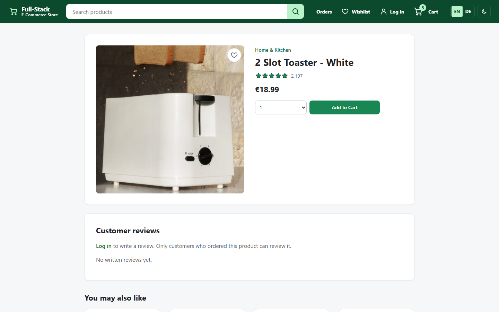
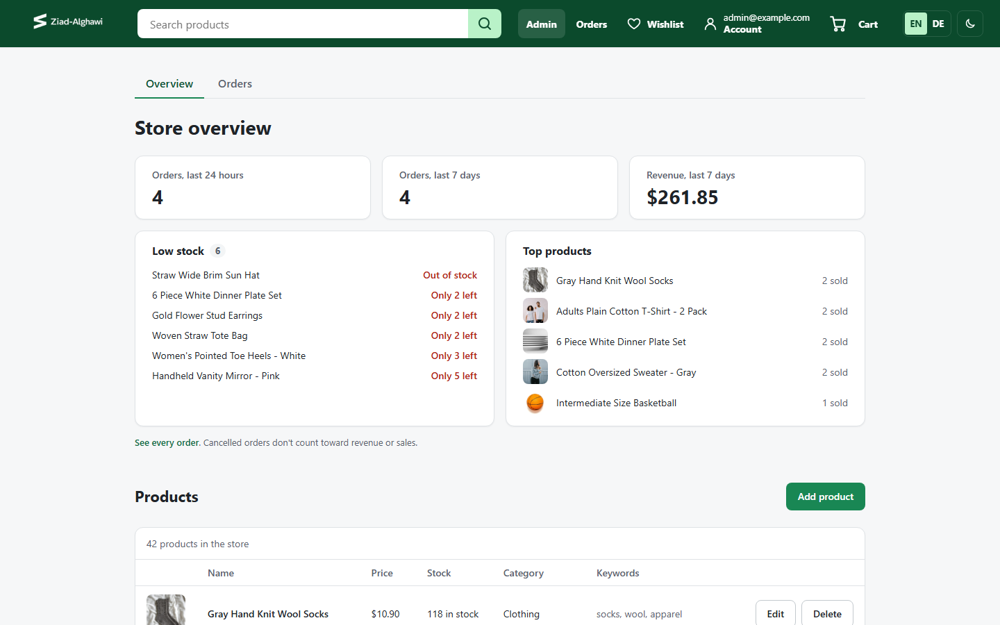
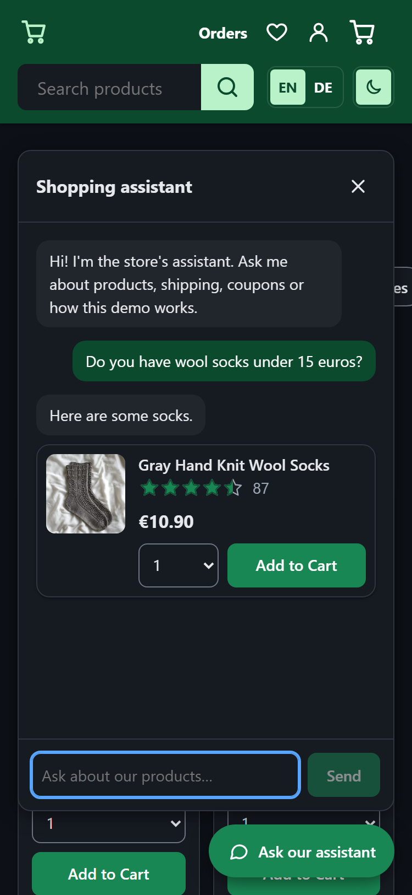
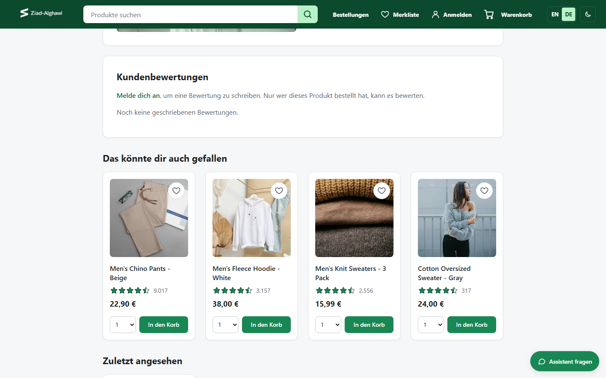
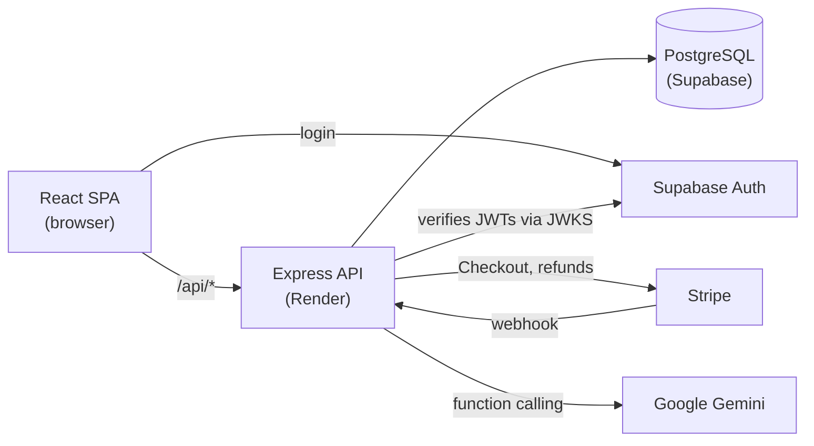

# Full-Stack E-Commerce Store

A complete online store with a React frontend, an Express API and PostgreSQL: catalog and search, cart, coupons, card payments through Stripe, customer accounts, an admin area and an AI shopping assistant.

[](https://github.com/Ziad-Alghawi/fullstack-ecommerce-store/actions/workflows/ci.yml)

**Live demo: https://shop.ziadalghawi.com**

> The demo runs on a free server that sleeps when idle, so the first visit can take about a minute to load.


## Try It

- **Card payment:** use Stripe's test card `4242 4242 4242 4242` with any future expiry date and any CVC. Payments run in Stripe test mode, so no money moves.
- **Coupon:** enter `WELCOME10` at checkout for 10% off the items.
- **Assistant:** open the chat button and ask for products under a price, or about shipping and coupons.
- **Other things to click:** cancel an order before it ships (stock returns, a card payment is refunded), save products to a wishlist after signing up, and switch to German or dark mode in the header.

The admin area needs an account listed in `ADMIN_USER_IDS`, so it is only shown in the [screenshots](#screenshots).

## Features

**Shopping**
- Search, categories, price filter and sorting by price, rating or newest, all kept in the URL
- Product pages with verified reviews (only customers who ordered the product can review it) and related and recently viewed products
- Stock per product: low stock is shown and sold out products can't be added to the cart
- Cart with quantities, three delivery options and a live payment summary
- English and German, a dark mode that follows the system theme, and prices in euros formatted per language

**Accounts and payments**
- Guests get a cart and order history per browser. Optional accounts (email and password, password reset) keep them on every device, and the guest cart moves to the account on login
- Pay on delivery, or by card with Stripe Checkout in test mode
- Order statuses (processing, shipped, delivered, cancelled), package tracking, and cancelling until an order ships
- A wishlist for logged in customers

**AI assistant**
- A chat assistant on the Google Gemini API that answers in the store's language, about this store only
- It uses function calling with two read-only tools (search products, get one product), so product names and prices come from the database, not from the model
- Products it finds appear as the shop's own cards with an Add to Cart button
- Limits per visitor, per IP address and per day for the whole store, plus short messages, a capped answer length and a timeout

**Admin**
- Overview: recent orders, weekly revenue, low stock products and best sellers
- Orders table filtered by status and payment, with actions to ship, deliver or cancel
- Create, edit and delete products and coupons, and remove reviews

**Quality**
- Unit, API and end-to-end tests, run by GitHub Actions on every push
- Accessibility checked with axe in both themes, keyboard focus handled across pages
- Security headers with a content security policy, rate limits, body size limits and admin checks on every admin route
- Loading, empty and error states with retry on every page

## Screenshots

| Product page | Checkout |
| --- | --- |
|  |  |
| **Admin overview and products** | **Admin orders** |
|  |  |
| **Shopping assistant** | **Assistant on a phone, in dark mode** |
|  |  |
| **Wishlist in dark mode** | **Product page in German** |
|  |  |

## Architecture

In production one Express service serves both the JSON API under `/api` and the built React app, so the browser talks to a single origin.



Key decisions:

- **JWTs verified through JWKS.** Supabase signs login tokens with an asymmetric key. The API checks them against the project's public keys with `jose`, so it holds no secret, and who is an admin is decided only from the verified token.
- **Idempotent Stripe orders.** The API builds every payment from the cart in the database, so nothing the browser sends sets a price. An order is created only after Stripe confirms the payment, through the webhook or the page the customer returns to, and one payment always makes exactly one order. Cancelling refunds first, with an idempotency key, so a repeated cancel can't refund twice.
- **Read-only AI tools with rate limits.** The model can only call two read-only product lookups. What visitors type reaches it as a message and unlocks nothing else. Per-visitor, per-IP and daily limits cap the cost.
- **One public URL.** `PUBLIC_SITE_URL` is the store's only address, used for link previews, the canonical link, Stripe's return pages, password-reset emails and CORS. Render's own `onrender.com` address redirects to it with a 301.
- **The API decides.** Prices, discounts, stock, totals and allowed status changes are all worked out on the server. Stock changes use single conditional updates, so two cancels at once can't return stock twice.

## Tech Stack

| Area | Technology |
| --- | --- |
| Frontend | React 19 (React Compiler), TypeScript, Vite, React Router, Axios, Day.js |
| Backend | Node.js 22, Express, Sequelize, helmet, express-rate-limit |
| Database | PostgreSQL on Supabase in production, SQLite locally |
| Auth | Supabase Auth, tokens verified with jose |
| Payments | Stripe Checkout (test mode) |
| AI | Google Gemini API with function calling |
| Testing | Vitest and Testing Library, Node test runner, Playwright with axe |
| Tooling and hosting | ESLint, GitHub Actions, Render |

## Testing and CI

| Suite | Tool | Tests |
| --- | --- | --- |
| Frontend unit | Vitest, Testing Library | 239 in 39 files |
| API | Node test runner, against the real server | 91 |
| End-to-end | Playwright, axe | 23 |

Lighthouse (mobile): **97 / 100 / 96 / 100** for performance, accessibility, best practices and SEO.

API tests start the server on a throwaway database and use local stand-ins for Supabase Auth, Stripe and Gemini, so no accounts or keys are needed. GitHub Actions runs lint, unit tests, API tests (on SQLite and on Postgres, as in production), the build and the end-to-end tests on every push.

```bash
npm run lint && npm test && npm run build
npm --prefix ecommerce-backend run lint && npm --prefix ecommerce-backend test
npx playwright install chromium   # once
npm run test:e2e
```

To run the API tests on Postgres, set `TEST_DATABASE_URL` to an empty throwaway database.

## Local Setup

Requires Node.js 22 or newer.

```bash
git clone https://github.com/Ziad-Alghawi/fullstack-ecommerce-store.git
cd fullstack-ecommerce-store
npm install
npm --prefix ecommerce-backend install

npm run dev:backend   # API on http://localhost:3000, creates a SQLite file and demo data
npm run dev           # frontend on http://localhost:5173, in a second terminal
```

The dev server forwards API requests to the backend. With no settings, the store runs in guest-only mode with pay on delivery. The frontend reads `.env.local` ([.env.example](.env.example)) and the backend reads `ecommerce-backend/.env` ([ecommerce-backend/.env.example](ecommerce-backend/.env.example)).

| Variable | Where | What it does |
| --- | --- | --- |
| `VITE_SUPABASE_URL`, `VITE_SUPABASE_PUBLISHABLE_KEY` | Frontend | Supabase project URL and publishable key. Together they turn on login |
| `VITE_API_URL` | Frontend | The API's URL, only when hosted apart from the frontend |
| `DATABASE_URL` | Backend | Postgres connection string. Without it, a local SQLite file is used |
| `SUPABASE_URL` | Backend | Same project URL, used to verify tokens |
| `ADMIN_USER_IDS` | Backend | Comma-separated Supabase user IDs of the admins |
| `STRIPE_SECRET_KEY`, `STRIPE_WEBHOOK_SECRET` | Backend | Stripe test key and webhook signing secret. Without the key, card payment is hidden |
| `GEMINI_API_KEY` | Backend | Google Gemini API key. Without it, the assistant is hidden |
| `CHAT_MODEL`, `CHAT_DAILY_LIMIT` | Backend | The assistant's model and the most answers it gives per day |
| `PUBLIC_SITE_URL` | Backend | The store's public address. Leave empty locally |
| `CORS_ORIGIN`, `DEMO_RESTOCK`, `PORT` | Backend | CORS origins, the daily demo restock switch, and the server port |

Deployment to Render, the Supabase and Stripe setup, and the full API reference are in [ecommerce-backend/documentation.md](ecommerce-backend/documentation.md).

## Known Limitations

- Stripe runs in test mode only, so no real payments can be made.
- The demo is on free tiers: the server sleeps when idle, and Supabase's built-in email service only sends a few emails an hour, so password reset emails to arbitrary addresses are unreliable.
- The assistant has a daily answer limit for the whole store, so it can be unavailable late in the day, and it is hidden without a Gemini key.
- The catalog is demo data, restocked once a day, and the product photos come from Unsplash and Pexels ([credits](public/images/products/CREDITS.md)).
- Local development uses SQLite, which is not transactional in this setup, so stock handling relies on conditional updates rather than transactions.
- Translations cover English and German only, and a few rare admin form messages stay in English.

## Author

Ziad Alghawi. [ziadalghawi.com](https://ziadalghawi.com)
