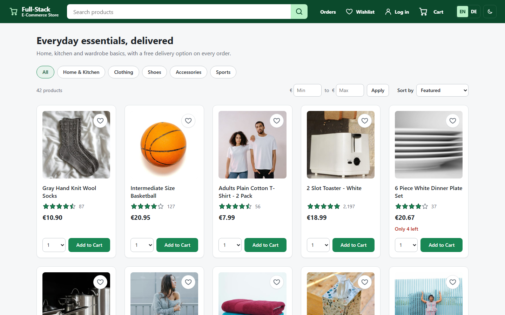
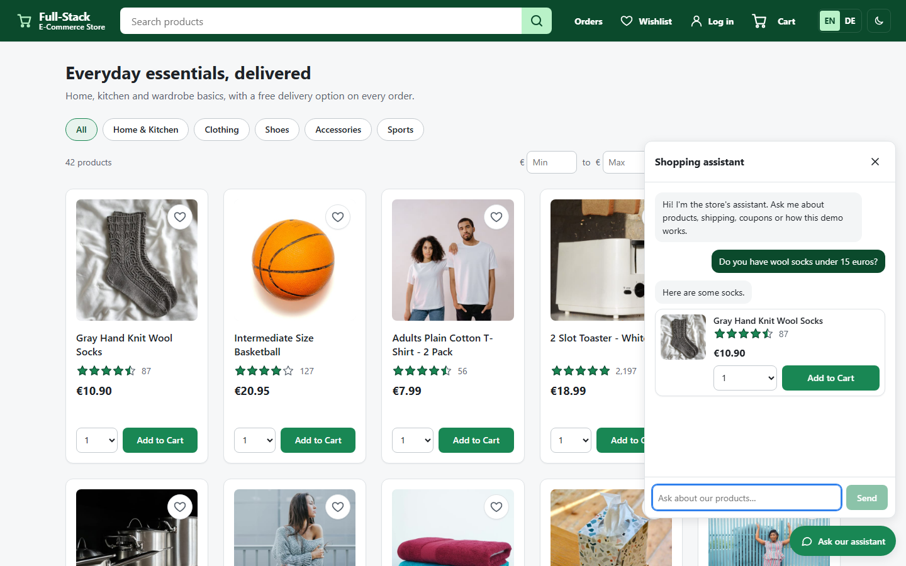
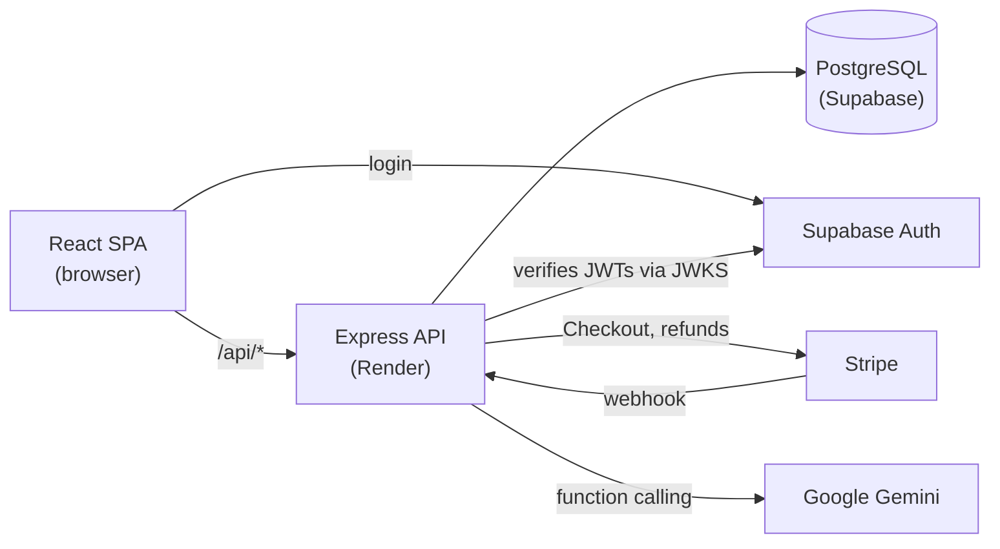

# Full-Stack E-Commerce Store

An online store with a React frontend, an Express API and PostgreSQL. It has a catalog with search, a cart, coupons, Stripe card payments, customer accounts, an admin area and an AI shopping assistant.

[](https://github.com/Ziad-Alghawi/fullstack-ecommerce-store/actions/workflows/ci.yml)

Live demo: https://shop.ziadalghawi.com

> The demo runs on a free Render instance. A scheduled ping keeps it awake during the European day (06:00 to 22:00 UTC); at night it sleeps, and the first request can take about a minute.



## Try It

- Card payment: Stripe test card `4242 4242 4242 4242`, any future expiry date, any CVC. Stripe runs in test mode.
- Coupon: `WELCOME10` gives 10% off the items.
- Assistant: open the chat button and ask for products under a price, or about shipping and coupons.
- Also: cancel an order before it ships (stock is returned, card payments are refunded), save products to a wishlist after signing up, switch to German or dark mode in the header.

The admin area requires an account listed in `ADMIN_USER_IDS`, so it is only shown in the [screenshots](#screenshots).

## Features

### Shopping
- Search, categories, price filter and sorting (price, rating, newest), stored in the URL
- Product pages with reviews from customers who ordered the product, plus related and recently viewed products
- Stock per product; low stock is shown and sold-out products can't be added to the cart
- Cart with quantities, three delivery options and a payment summary
- English and German, dark mode following the system theme, euro prices formatted per language

### Accounts and payments
- Guests get a cart and order history per browser. Optional accounts (email and password, password reset) share them across devices; the guest cart moves to the account on login
- Pay on delivery, or by card through Stripe Checkout (test mode)
- Order statuses (processing, shipped, delivered, cancelled), package tracking, cancelling until an order ships
- Wishlist for logged-in customers

### AI assistant
- Chat assistant on the Google Gemini API, answering in the store's language and only about this store
- Function calling with two read-only tools (search products, get one product), so names and prices come from the database
- Products it returns are shown as the shop's product cards with an Add to Cart button
- Limits per visitor, per IP address and per day, plus a message length limit, a capped answer length and a timeout

### Admin
- Overview: recent orders, weekly revenue, low-stock products, best sellers
- Orders table filtered by status and payment method, with ship, deliver and cancel actions
- Create, edit and delete products and coupons; remove reviews

### Quality
- Unit, API and end-to-end tests, run by GitHub Actions on every push
- Accessibility checked with axe in both themes; keyboard focus handled across pages
- Security headers with a content security policy, rate limits, body size limits, admin checks on every admin route
- Loading, empty and error states with retry on every page

## Screenshots

| Product page | Checkout |
| --- | --- |
|  |  |
| Admin overview and products | Admin orders |
|  |  |
| Shopping assistant | Assistant on a phone, dark mode |
|  |  |
| Wishlist, dark mode | Product page in German |
|  |  |

## Architecture

In production a single Express service serves the JSON API under `/api` and the built React app, so the browser talks to one origin.



Design notes:

- JWT verification via JWKS. Supabase signs tokens with an asymmetric key. The API verifies them against the project's public keys with `jose`, so it holds no secret. Admin status is read only from the verified token.
- Idempotent Stripe orders. Every payment is built from the cart in the database; the browser never sets a price. An order is created only after Stripe confirms the payment, from either the webhook or the return page, and one payment always produces exactly one order. Cancelling refunds first with an idempotency key, so a repeated cancel can't refund twice.
- Read-only AI tools with rate limits. The model can only call two read-only product lookups. User input reaches it as a message and grants no other access. Per-visitor, per-IP and daily limits cap the cost.
- One public URL. `PUBLIC_SITE_URL` is used for link previews, the canonical link, Stripe return pages, password-reset emails and CORS. Render's `onrender.com` address redirects to it with a 301.
- Server-side rules. Prices, discounts, stock, totals and allowed status changes are computed on the server. Stock changes use single conditional updates, so two concurrent cancels can't return stock twice.

## Tech Stack

| Area | Technology |
| --- | --- |
| Frontend | React 19 (React Compiler), TypeScript, Vite, React Router, Axios, Day.js |
| Backend | Node.js 22, Express, Sequelize, helmet, express-rate-limit |
| Database | PostgreSQL on Supabase in production, SQLite locally |
| Auth | Supabase Auth, tokens verified with jose |
| Payments | Stripe Checkout (test mode) |
| AI | Google Gemini API with function calling |
| Testing | Vitest and Testing Library, Node test runner, Playwright with axe |
| Tooling and hosting | ESLint, GitHub Actions, Render |

## Testing and CI

| Suite | Tool | Tests |
| --- | --- | --- |
| Frontend unit | Vitest, Testing Library | 239 in 40 files |
| API | Node test runner, against the real server | 91 |
| End-to-end | Playwright, axe | 23 |

Lighthouse (mobile): 97 / 100 / 96 / 100 for performance, accessibility, best practices and SEO.

The API tests start the server on a throwaway database, one per test file, with local stand-ins for Supabase Auth, Stripe and Gemini, so no accounts or keys are needed. GitHub Actions runs lint, unit tests, API tests (on SQLite and on Postgres), the build and the end-to-end tests on every push.

```bash
npm run lint && npm test && npm run build
npm --prefix ecommerce-backend run lint && npm --prefix ecommerce-backend test
npx playwright install chromium   # once
npm run test:e2e
```

To run the API tests on Postgres, set `TEST_DATABASE_URL` to a server where the user can create databases. Each test file creates its own database and drops it afterwards.

## Local Setup

Requires Node.js 22 or newer.

```bash
git clone https://github.com/Ziad-Alghawi/fullstack-ecommerce-store.git
cd fullstack-ecommerce-store
npm install
npm --prefix ecommerce-backend install

npm run dev:backend   # API on http://localhost:3000, creates a SQLite file and demo data
npm run dev           # frontend on http://localhost:5173, in a second terminal
```

The Vite dev server proxies API requests to the backend. Without any settings the store runs in guest-only mode with pay on delivery. The frontend reads `.env.local` ([.env.example](.env.example)), the backend reads `ecommerce-backend/.env` ([ecommerce-backend/.env.example](ecommerce-backend/.env.example)).

| Variable | Where | Purpose |
| --- | --- | --- |
| `VITE_SUPABASE_URL`, `VITE_SUPABASE_PUBLISHABLE_KEY` | Frontend | Supabase project URL and publishable key; both are needed to enable login |
| `VITE_API_URL` | Frontend | API URL, only when it is hosted separately from the frontend |
| `DATABASE_URL` | Backend | Postgres connection string. Without it, a local SQLite file is used |
| `SUPABASE_URL` | Backend | Same project URL, used to verify tokens |
| `ADMIN_USER_IDS` | Backend | Comma-separated Supabase user IDs of the admins |
| `STRIPE_SECRET_KEY`, `STRIPE_WEBHOOK_SECRET` | Backend | Stripe test key and webhook signing secret. Without the key, card payment is hidden |
| `GEMINI_API_KEY` | Backend | Google Gemini API key. Without it, the assistant is hidden |
| `CHAT_MODEL`, `CHAT_DAILY_LIMIT` | Backend | Assistant model and maximum answers per day |
| `PUBLIC_SITE_URL` | Backend | The store's public address. Leave empty locally |
| `CORS_ORIGIN`, `DEMO_RESTOCK`, `PORT` | Backend | CORS origins, daily demo restock switch, server port |

Render deployment, Supabase and Stripe setup, and the API reference are in [ecommerce-backend/documentation.md](ecommerce-backend/documentation.md).

## Known Limitations

- Stripe runs in test mode only.
- The demo uses free tiers: the server sleeps at night, and Supabase's built-in email service sends only a few emails per hour, so password reset emails are unreliable.
- The assistant has a store-wide daily answer limit, so it can be unavailable late in the day. It is hidden without a Gemini key.
- The catalog is demo data, restocked once a day. Product photos are from Unsplash and Pexels ([credits](public/images/products/CREDITS.md)).
- Local development uses SQLite, which is not transactional in this setup, so stock handling relies on conditional updates instead of transactions.
- Only English and German are supported, and a few rare admin form messages are English only.

## Author

Ziad Alghawi. [ziadalghawi.com](https://ziadalghawi.com)
